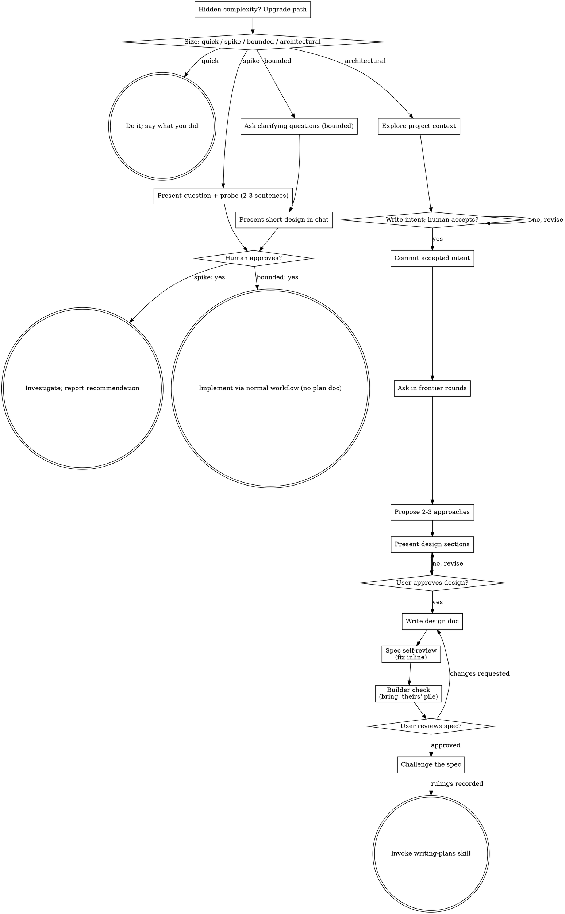

# Brainstorming Ideas Into Designs

You are very good at building. You build what you believe your human
partner wants, and that belief is usually thinner than it feels. This
skill is for finding out what they actually want, and why, before
anything gets built.

People often haven't finished working out what they want. Good questions
help them think it through. When you understand the why, you make the
hundred decisions they never mention the way they would have made them.

Start by sizing how much process the request needs, then work through
your path: understand the context, write the intent, refine the idea,
present a design, and get your human partner's approval.

## First: What Do You Actually Know?

Before you reply, ask yourself: what do I know about what they want, and
why?

- **Everything that matters is in the request** ("make the icon cornflower
  blue"), and it changes something that already exists here. This is a
  quick, clear task. Do it, and say what you did.
- **Something non-trivial is missing.** Size the work (below), say the
  size, and start the conversation.

If you would have to guess at anything that matters, it is not quick.

## Your First Message

Your first message is three things, in this order:

1. The size, out loud: "this looks bounded, so I'll present a short
   design here rather than write a spec." Your human partner can
   override it.
2. One line letting them know that if they'd rather skip the questions and
   have you just start, they can say so. If they take you up on it on the
   spike or bounded path, this skill is done: state any significant
   how-it-gets-made choice (platform, language, medium) in one plain line,
   then do what they asked through the normal workflow. On the
   architectural path the opt-out skips the questions, not the gates:
   write the intent from the request, mark every guess as yours, and stop
   for acceptance as usual.
3. One open question that gets them describing. Ask about a real moment
   or a concrete picture: "What's the moment you find yourself wishing
   this existed?" or "Tell me about the people who'll be in the room."
   On the architectural path this is the one purpose question allowed
   before the intent.

That's the whole message.

## Establish Shared Understanding

The outcome of brainstorming is an understanding your human partner can
recognize and correct, grounded in what they want to accomplish.

1. **Discover intent.** Use the request and available context to identify
   the intended outcome, who it is for, and what success looks like. When
   that information is missing, ask one focused question about purpose or
   intended use before proposing features or an approach. Knowing the app
   genre does not tell you why your partner wants it. Gathering missing
   requirements does not ask them to authorize the task again.
2. **Write back your understanding.** Summarize the intended outcome,
   relevant constraints, and success criteria in a short note your partner
   can assess. Separate what they said from assumptions. Invite correction
   and incorporate their answer before treating this as the design brief.
   On the architectural path the intent file is this write-back: write it
   with the Intent template below, not as a separate note.
3. **Carry intent into the design.** Preserve the agreed understanding in
   the selected path's design artifact: the written spec for architectural
   work, or the in-chat design/probe for bounded work and spikes. Check
   proposed features and technical choices against that understanding.

When the request already supplies the purpose and constraints, reflect
that understanding instead of asking the same questions again. Keep the
note concise; its accuracy and the opportunity to correct it matter.

<HARD-GATE>
Before taking any implementation action, including invoking an
implementation skill, writing product code, scaffolding, installing
product dependencies, or creating an external project, complete the
selected path's prerequisites:

- Quick: none; the request is the full description.
- Spike: the human partner approves the question and probe.
- Bounded: the human partner approves the short in-chat design.
- Architectural: the human partner accepts and commits the intent,
  then reviews and approves the written spec; the spec is challenged
  (if a `challenge` skill is installed) and its rulings recorded; then
  the partner reviews the written implementation plan and selects its
  execution method. Conversational design approval only permits writing
  the spec. Written-spec approval only permits `challenge` and then writing-plans.

A reply approves the stage actually presented. Approval of an idea or
feature scope does not approve artifacts that do not exist yet. Resume
at the earliest incomplete stage; do not turn one approval into permission
to skip the rest of the selected path. Read-only project exploration is
allowed while those prerequisites remain incomplete.

Two exceptions. If they opted out of the questions on the spike or
bounded path, the skill is done and the gate goes with it; on the
architectural path every gate above still holds. A spike they said yes
to may be built; it stays labeled throwaway, and keeping what it produced
is a new request that comes back through this gate.
</HARD-GATE>

## Size the Work

Before your first question, pick a size and say it out loud so your
human partner can override it:

| Size | The full description | Then |
|------|----------------------|------|
| Quick | the request itself | do it, say what you did |
| Spike | the question and probe, in chat | investigate, report a recommendation |
| Bounded | a short design, in chat | build it through the normal workflow, no plan document |
| Architectural | intent, then a written spec | challenge, then a full plan (superpowers:writing-plans) |

- **Quick** — everything that matters is in the request and it changes
  something already here (see First: What Do You Actually Know?). One
  guess that matters makes it bounded.
- **Spike** — a feasibility question ("can we...", "is it possible...",
  "quick and dirty is fine") whose output is an answer, not code you
  keep. Present the question and what you'll try in 2-3 sentences, get
  a nod, then find out as cheaply as correctness allows. No design
  doc, no spec file. Report findings as a recommendation; anything you
  built stays labeled throwaway.
- **Bounded** — a well-scoped change to code that already exists in
  this repo: a new flag, a small endpoint, a one-file fix.
  Understanding the kind of app is not enough — bounded means the flow
  you are changing is already here to read. If there is no existing
  flow to change, the task is not bounded. Ask the clarifying
  questions that matter, present a short design IN CHAT (a few
  sentences to a few short paragraphs), and STOP. Implementation
  starts only after your human partner says yes to that design — a
  bounded task's approval is as hard a gate as an architectural
  one. No spec file, no implementation plan document.
- **Architectural** — new projects, new subsystems, changes that
  restructure how components fit together or alter interfaces others
  depend on. Follow the full process: intent (written, accepted,
  committed first), frontier-round questions, approaches, sectioned
  design, written spec, builder check, then `challenge` on the spec if
  installed, then the writing-plans skill.

When in doubt between two sizes, take the heavier one. The ratchet is
one-way: hidden complexity discovered mid-task upgrades the size —
stop, say so, and step up. Nothing downgrades mid-task.

If this is really several independent projects, say so, agree on an
order, and brainstorm them one at a time.

## The Conversation

On the spike and bounded paths, and on the architectural path until the
intent is committed, each message ends with one question: a single
sentence with no list of example answers hanging off it. After the intent
commit, the architectural path asks in frontier rounds instead (Checklist
step 4). Use plain language, pitched just a little above where your human
partner is. Match their vocabulary; never use process jargon.

Be clear and concise. Lead with what matters. Avoid jargon. When you
report what you found, give them the most important findings and offer
the rest.

**Get them describing.** Open questions come first. Their own words carry
intent that your options can't. Offer a short menu only when they're
stuck. When they say "just guess" or "what do you think?", propose
something concrete.

**How it gets made.** Every project rests on choices about medium, tools,
materials, and resources: the platform, programming language, and
libraries for an app; the medium for a piece of art. Find out early which
of those choices they want to make, which they're handing to you, and what
they already have to work with. Someone with strong views or skills will
want to talk it through. Someone counting on you needs sensible defaults,
said in plain words. When there's existing work, build on what it already
uses. Any choice you make goes in the design as your call, never as
something they agreed to.

**Ground to cover.** This is territory, not a script. Never read these
out as questions:

- what kind of thing this is, and what makes it special
- why now, and what success looks like to them
- goals, non-goals, and anti-goals (what would make this a failure even
  if it technically works)
- prior art: what they've seen elsewhere, loved or hated
- current state: what exists now, what they've tried
- the details they care about

**Questions that work** anchor in specifics: "Walk me through the last
time...", "If it could only do one of these well, which?", "What would
make you wince if I got it wrong?" A guess they can correct ("I'm
guessing this is because X keeps biting you?") often beats a question.

**Look things up; offer recon.** Anything answerable from the repo or
the environment you look up yourself (read-only exploration is always
allowed), never ask. For their own files and data outside the project,
or the web, offer to go look: say what you'd look for. They decide
whether you go.

**Think wide privately.** Before you propose anything, come up with
several ideas and drop the weak ones, including any that fight what
they've told you about why. Show the comparison only when it helps them
decide.

**Show, don't tell.** Offer the visual companion (below) whenever seeing
would help more than reading:

- something they'll look at: a screen, a page, a printout, a sign
- a layout or arrangement: of a screen, a room, a schedule
- a flow or a sequence of steps
- options that would look different from each other
- a structure that's easier to see than read: a diagram, a timeline, a map

Once they've accepted, use it for mockups to react to, side-by-side
options, and throwaway prototypes they can click.

**Spike to feel things out.** Agentic work is waterfall, but very, very
fast. A quick throwaway build is often the cheapest way to learn what
they want or whether something works. Offer one when it would help.
When they just want to spike, get out of the way. Spikes get no tests
or minimal ones, aren't bulletproof, and skip the plan, implementation,
and review process. Bring what the spike taught you back into the
conversation.

## Play It Back

Play back as you go. As soon as you understand one part well enough to
describe it (what it's for and who it serves, say, or how one piece
behaves), describe that part back in about 200-300 words, then return to
questions about the next part. Playback and questions alternate through
the whole conversation; the last chunk covers whatever is left. On the
architectural path the intent is the first playback, and the design
sections (Checklist step 6) are the later chunks.

Mark anything you're guessing as your guess; only what they said goes in
as theirs. End each chunk by asking what's wrong or missing.

Before you send a chunk, check it: does it describe something they'll
look at, like a page, a screen, a schedule, or a printout? If so, and
they haven't seen the visual companion offer yet, send the offer instead
(its own message, below) and hold the chunk for the next message. Once
they've accepted, put a mockup next to the description.

## Anti-Pattern: "Too Simple To Need Approval"

Every path except Quick ends with your human partner approving the
required design before implementation. A bounded change may need only
two sentences in chat. A new todo-list project is architectural and
requires the written spec and planning handoffs. Scale the artifact to
the selected path; complete that path's reviews before implementation.

## Red Flags

| Thought | Reality |
|---------|---------|
| "This is too simple to need a design" | Follow the selected path: a bounded change gets a short chat design; an architectural change gets the written spec and planning handoffs. |
| "It's quick, I'll just do it" | Quick means nothing that matters is missing. If you'd have to guess at anything that matters, it is bounded. |
| "I'll call it bounded and skip the spec" | Reaching for a label to skip work IS the doubt — take the heavier path. |
| "It's bounded and the design is obvious — I'll start while they read it" | The gate is the approval, not the design's length. Present, then stop until you hear yes. |
| "I understand this kind of app, so it's bounded" | Bounded measures the repo, not your familiarity. A new project has no existing flow — it is architectural. |
| "The spike works, so I'll keep the code" | A spike's output is an answer. Keeping the code is a new request — classify it. |
| "It grew, but I'm almost done — no need to re-classify" | Hidden complexity upgrades the path mid-task. Stop and say so. |
| "They approved the spike, so the follow-up change is approved too" | Each task gets its own classification and its own approval. |
| "They said skip the questions, so the intent can go too" | On the architectural path the opt-out skips questions, not gates. Write the intent from the request and stop for acceptance. |
| "I'll write the intent after the design, once I know what it is" | The intent is what the design is checked against. Write it first, get the yes, commit, then design. |
| "Twelve questions, one per message, is thorough" | On the architectural path that is twelve round trips with no view of dependencies. Ask the frontier in one round with recommended answers. |
| "I'll offer options to save them effort" | Options steer. Ask them to describe it first. |
| "I'll fill in sensible defaults" | Good. Say them out loud. A default they never heard is one they couldn't reject. |
| "I should explain the process first" | Ask your question. The process shows itself. |
| "They said 'sounds good' to the idea" | Approval covers what you showed them. A description you haven't written isn't approved. |

## Checklist

Size first, announce the path, then create a task for each item on
your path and complete them in order.

**Quick:**
1. **Do it** — through the normal development workflow
2. **Say what you did**

**Spike:**
1. **Explore project context** — enough to frame the probe
2. **Present question + probe plan** — 2-3 sentences
3. **Get approval** — a nod is enough
4. **Investigate** — as cheaply as correctness allows
5. **Report findings** — a recommendation; label anything built as throwaway

**Bounded:**
1. **Explore project context** — check files, docs, recent commits
2. **Ask clarifying questions** — one at a time, the ones that matter
3. **Present short design in chat** — approach, files touched, testing
4. **Get approval** — STOP and wait for an explicit yes; presenting the design and starting in the same breath is skipping the gate
5. **Implement** — proceed with the normal development workflow (TDD applies); no plan document

**Architectural:**
1. **Explore project context** — check files, docs, recent commits
2. **Write the intent** — before any design question, approach, or design (one purpose question may come first): write `docs/superpowers/intents/YYYY-MM-DD-<topic>.md` using the Intent template below, present it, and STOP. On an explicit yes, set `Status: accepted` and commit it. Nothing downstream starts before that commit. A heading with nothing to say gets one line saying so ("None known."); never drop a heading.
3. **Offer the visual companion just-in-time** — NOT upfront. The first time a question would genuinely be clearer shown than described, offer it then (its own message); on approval its browser tab opens for you. If no visual question ever arises, never offer it. See the Visual Companion section below.
4. **Ask in frontier rounds** — the frontier is every question whose prerequisites are already settled. Ask the whole frontier in one numbered message, each question with your recommended answer. A question that depends on another still open in this round waits for the next round. Facts are your job: anything answerable from the repo or the environment is looked up (dispatch `subagent_type: Explore`, `model: sonnet` when it is more than a grep), never asked. Done when the frontier is empty and nothing is silently assumed. Round format:

   ```
   ❓ **Q1** - **<title>**: <question, options if any>
   ➡️ <your recommended answer>
   ---
   ❓ **Q2** - ...
   ```
5. **Propose 2-3 approaches** — with trade-offs and your recommendation
6. **Present design** — in sections scaled to their complexity, get user approval after each section
7. **Write design doc** — save to `docs/superpowers/specs/YYYY-MM-DD-<topic>-design.md` with the header line `Intent: <path to the accepted intent file>`, and commit
8. **Spec self-review** — quick inline check for placeholders, contradictions, ambiguity, scope (see below); also every Constraint in the intent is satisfied by the spec or explicitly waived with a reason
9. **Builder check** — dispatch a fresh subagent with `builder-check-prompt.md`; sort its questions and bring only the "theirs" pile to your human partner (see The Written Design)
10. **User reviews written spec** — ask user to review the spec file before proceeding
11. **Challenge the spec** — if a `challenge` skill is installed, invoke it on the committed spec with the intent path in its brief; rule on every finding and Flag, record the rulings in the spec under a `## Challenge rulings` heading, add `Challenge: YYYY-MM-DD <verdict>` to the spec header (before its first `## ` heading) — map the challenge verdict to the field — "holds" → `holds`, "holds with conditions" → `holds-with-conditions`, "broken" with every finding and Flag ruled → `broken-ruled` (a "broken" verdict with unruled findings may not be recorded) — commit
12. **Transition to implementation** — invoke writing-plans skill to create implementation plan

**Intent template** (exactly these five H2 headings, this order):

```markdown
# Intent: <topic>
Author: <who asked>. Status: draft

## Problem
<what hurts, from the asker's perspective>

## Proposed outcome
<what is true when this is done>

## Affected users and systems
<who and what this touches>

## Constraints
<what the design must respect; the challenger checks the spec against these>

## Open questions
<what is not yet decided; "None known." if empty>
```

## Process Flow



**Terminal states are path-bound.** Architectural: after the spec is
approved, the ONLY skills you invoke are `challenge` (on the committed
spec, if installed) and then writing-plans — never frontend-design,
mcp-builder, or any other implementation skill. Bounded: after
approval, implementation proceeds directly through the normal
development workflow; no plan document. Spike: the terminal state is a
reported recommendation. Quick: the terminal state is the done task and
one line saying what you did.

## The Process

The subsections below serve the bounded and architectural paths (a
spike stops at "present the probe, get a nod"). Sections from
**Exploring approaches** onward are architectural-path depth — for
bounded work, context plus a few questions plus a short in-chat design
is the whole process.

**Understanding the idea:**

- Check out the current project state first (files, docs, recent commits)
- Before asking detailed questions, assess scope: if the request describes multiple independent subsystems (e.g., "build a platform with chat, file storage, billing, and analytics"), flag this immediately. Don't spend questions refining details of a project that needs to be decomposed first.
- If the project is too large for a single spec, help the user decompose into sub-projects: what are the independent pieces, how do they relate, what order should they be built? Then brainstorm the first sub-project through the normal design flow. Each sub-project gets its own intent → spec → challenge → plan → implementation cycle.
- Bounded path only: ask questions one at a time to refine the idea; only one question per message - if a topic needs more exploration, break it into multiple questions
- Architectural path: ask in frontier rounds (checklist step 4); the intent file is already committed by the time the first round is asked
- Open questions first; offer a short menu only when they're stuck (see The Conversation)
- Focus on understanding: purpose, constraints, success criteria

**Exploring approaches:**

- Propose 2-3 different approaches with trade-offs
- Present options conversationally with your recommendation and reasoning
- Lead with your recommended option and explain why
- YAGNI ruthlessly - remove unnecessary features from every approach and design

**Presenting the design:**

- Once you believe you understand what you're building, present the design
- Scale each section to its complexity: a few sentences if straightforward, up to 200-300 words if nuanced
- Ask after each section whether it looks right so far
- Cover: architecture, components, data flow, error handling, testing
- Be ready to go back and clarify if something doesn't make sense

**Design for isolation and clarity:**

- Break the system into smaller units that each have one clear purpose, communicate through well-defined interfaces, and can be understood and tested independently
- For each unit, you should be able to answer: what does it do, how do you use it, and what does it depend on?
- Can someone understand what a unit does without reading its internals? Can you change the internals without breaking consumers? If not, the boundaries need work.
- Smaller, well-bounded units are also easier for you to work with - you reason better about code you can hold in context at once, and your edits are more reliable when files are focused. When a file grows large, that's often a signal that it's doing too much.

**Working in existing codebases:**

- Explore the current structure before proposing changes. Follow existing patterns.
- Where existing code has problems that affect the work (e.g., a file that's grown too large, unclear boundaries, tangled responsibilities), include targeted improvements as part of the design - the way a good developer improves code they're working in.
- Don't propose unrelated refactoring. Stay focused on what serves the current goal.

## The Written Design

Architectural path. Write a plain document a talented builder in the
domain could plan from without going back to your human partner. Cover:

- intent and the why
- goals, non-goals, anti-goals
- constraints
- the parts of the how they decided, as they decided them
- what's left to the builder

**Documentation:**

- The spec's header carries the line `Intent: <path to the accepted intent file>` so the challenger and the plan can find it
- Write the validated design (spec) to `docs/superpowers/specs/YYYY-MM-DD-<topic>-design.md`
  - Outside a software repo, ask where it goes. User preferences for spec location override both.
- Use elements-of-style:writing-clearly-and-concisely skill if available
- Commit the design document to git

**Spec Self-Review:**
After writing the spec document, look at it with fresh eyes:

1. **Placeholder scan:** Any "TBD", "TODO", incomplete sections, or vague requirements? Fix them.
2. **Internal consistency:** Do any sections contradict each other? Does the architecture match the feature descriptions?
3. **Scope check:** Is this focused enough for a single implementation plan, or does it need decomposition?
4. **Ambiguity check:** Could any requirement be interpreted two different ways? If so, pick one and make it explicit.
5. **Intent check:** Every line under the intent's Constraints heading is either satisfied by the spec or explicitly waived in the spec with a reason. An unmentioned constraint is a gap; fix it.

Fix any issues inline. No need to re-review — just fix and move on.

**Builder check:** dispatch a fresh general-purpose subagent (`model:
sonnet`) with `builder-check-prompt.md` in this directory. When you tell
your human partner you're writing it up, say a reviewer will read it
first and you may come back once with a few questions. Don't hand over
the document until the check is back. Sort what the builder asks into
three piles:

- **Answered already** by the conversation or the project: put the answer
  in the document.
- **Minor:** a sensible builder could settle it without changing what gets
  built. Settle it yourself and mark it in the document as your call.
- **Theirs:** only your human partner can answer it, and the answer changes
  what gets built.

Bring the "theirs" pile in one message, most important first. Update the
document with their answers, commit, then hand it over with a short list
of the calls you made so they can check those while reading. That's the
only round of questions the check produces. Without a subagent tool, read
the document as that builder yourself.

**User Review Gate:**
After the builder check, ask the user to review the written spec before proceeding:

> "Spec written and committed to `<path>`. The calls I made: <list>. Please review it and let me know if you want to make any changes before we challenge the spec and write out the implementation plan."

Wait for the user's response. If they request changes, make them and re-run the spec review loop. Only proceed once the user approves.

**Challenge, then implementation:**

- If a `challenge` skill is installed, invoke it on the committed spec. Its brief carries four things: the one-sentence claim, the spec path, the intent path, and the settled constraints. Rule on every finding and Flag, record the rulings in the spec under a `## Challenge rulings` heading, add `Challenge: YYYY-MM-DD <verdict>` (`holds`, `holds-with-conditions` or `broken-ruled`) to the spec header (before its first `## ` heading), commit.
- Then invoke the writing-plans skill to create a detailed implementation plan
- Do NOT invoke any other skill. challenge (when installed) and then writing-plans are the only next steps.

## Visual Companion

A browser tab for showing mockups, diagrams, and prototypes. It's a
tool, not a mode: accepting it doesn't send every question to the
browser.

**Offer it just-in-time.** Offer it the first time one of the Show,
don't tell moments comes up, never upfront. The offer is its own message
with nothing else in it — no clarifying question, summary, or other
content:

> "This might be easier if I show you. Want me to open a browser tab with some mockups?"

Wait for the user's response. If they accept, start the server with
`--open` so their browser opens to the first screen automatically. If
they decline, stay in text and don't offer again unless they raise it.

**Per question, ask: would they understand this better by seeing it?**

- **Use the browser** for content that IS visual — mockups, wireframes, layout comparisons, architecture diagrams, side-by-side visual designs
- **Use the terminal** for content that is text — requirements questions, conceptual choices, tradeoff lists, A/B/C/D text options, scope decisions

A question about a UI topic is not automatically a visual question. "What does personality mean in this context?" is a conceptual question — use the terminal. "Which wizard layout works better?" is a visual question — use the browser.

If they accept, read `visual-companion.md` in this directory before
starting the server.
