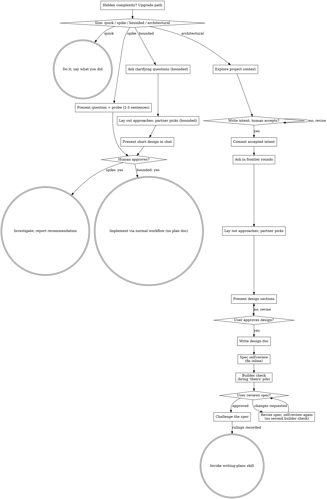

# Architectural Path

Part of superpowers:brainstorming. Read it before checklist step 2, and
again before steps 4, 7, 9 and 11.

## Checklist Detail

1. **Explore project context** — check files, docs, recent commits
2. **Write the intent** — before any design question, approach, or design (one purpose question may come first): write `docs/superpowers/intents/YYYY-MM-DD-<topic>.md` using the Intent template below, present it, and STOP. On an explicit yes, set `Status: accepted` and commit it. Nothing downstream starts before that commit. A heading with nothing to say gets one line saying so ("None known."); never drop a heading.
3. **Offer the visual companion just-in-time** — NOT upfront. The first time a question would genuinely be clearer shown than described, offer it then (its own message); on approval its browser tab opens for you. If no visual question ever arises, never offer it. See SKILL.md's Visual Companion section.
4. **Ask in frontier rounds** — the frontier is every question whose prerequisites are already settled. Ask the whole frontier in one numbered message, each question with your recommended answer. A question that depends on another still open in this round waits for the next round. Facts are your job: anything answerable from the repo or the environment is looked up (dispatch `subagent_type: Explore`, `model: sonnet` when it is more than a grep), never asked. Done when the frontier is empty and nothing is silently assumed. Round format:

   ```
   ❓ **Q1** - **<title>**: <question, options if any>
   ➡️ <your recommended answer>
   ---
   ❓ **Q2** - ...
   ```
5. **Lay out the approaches** — a message of their own: 2-3 ways with trade-offs and your recommendation; they pick one
6. **Present design** — in sections scaled to their complexity, get user approval after each section
7. **Write design doc** — save to `docs/superpowers/specs/YYYY-MM-DD-<topic>-design.md` with the header line `Intent: <path to the accepted intent file>`, and commit
8. **Spec self-review** — quick inline check for placeholders, contradictions, ambiguity, scope (see below); also every Constraint in the intent is satisfied by the spec or explicitly waived with a reason
9. **Builder check** — dispatch a fresh subagent with `builder-check-prompt.md`; sort its questions and bring only the "theirs" pile to your human partner (see The Written Design)
10. **User reviews written spec** — ask user to review the spec file before proceeding
11. **Challenge the spec** — if a `challenge` skill is installed, invoke it on the committed spec with the intent path in its brief; rule on every finding and Flag, record the rulings in the spec under a `## Challenge rulings` heading, add `Challenge: YYYY-MM-DD <verdict>` to the spec header (before its first `## ` heading) — map the challenge verdict to the field — "holds" → `holds`, "holds with conditions" → `holds-with-conditions`, "broken" with every finding and Flag ruled → `broken-ruled` (a "broken" verdict with unruled findings may not be recorded) — commit
12. **Transition to implementation** — invoke writing-plans skill to create implementation plan

## Intent Template

Exactly these five H2 headings, this order:

```markdown
# Intent: <topic>
Author: <who asked>. Status: draft

## Problem
<what hurts, from the asker's perspective>

## Proposed outcome
<what is true when this is done>

## Affected users and systems
<who and what this touches>

## Constraints
<what the design must respect; the challenger checks the spec against these>

## Open questions
<what is not yet decided; "None known." if empty>
```

## Process Flow



## The Process

The subsections below serve the bounded and architectural paths (a
spike stops at "present the probe, get a nod"). Sections from
**Exploring approaches** onward are architectural-path depth — for
bounded work, context, a few questions, the approaches message, and a
short in-chat design are the whole process.

**Understanding the idea:**

- Check out the current project state first (files, docs, recent commits)
- Before asking detailed questions, assess scope: if the request describes multiple independent subsystems (e.g., "build a platform with chat, file storage, billing, and analytics"), flag this immediately. Don't spend questions refining details of a project that needs to be decomposed first.
- If the project is too large for a single spec, help the user decompose into sub-projects: what are the independent pieces, how do they relate, what order should they be built? Then brainstorm the first sub-project through the normal design flow. Each sub-project gets its own intent → spec → challenge → plan → implementation cycle.
- Bounded path only: ask questions one at a time to refine the idea; only one question per message - if a topic needs more exploration, break it into multiple questions
- Architectural path: ask in frontier rounds (checklist step 4); the intent file is already committed by the time the first round is asked
- Open questions first; offer a short menu only when they're stuck (see The Conversation)
- Focus on understanding: purpose, constraints, success criteria

**Exploring approaches:**

- Lay out 2-3 approaches with trade-offs in a message of their own (see Lay out the approaches)
- Lead with your recommended option and explain why
- YAGNI ruthlessly - remove unnecessary features from every approach and design

**Presenting the design:**

- Once you believe you understand what you're building, present the design
- Scale each section to its complexity: a few sentences if straightforward, up to 200-300 words if nuanced
- Ask after each section whether it looks right so far
- Cover: architecture, components, data flow, error handling, testing
- Be ready to go back and clarify if something doesn't make sense

**Design for isolation and clarity:**

- Break the system into smaller units that each have one clear purpose, communicate through well-defined interfaces, and can be understood and tested independently
- For each unit, you should be able to answer: what does it do, how do you use it, and what does it depend on?
- Can someone understand what a unit does without reading its internals? Can you change the internals without breaking consumers? If not, the boundaries need work.
- Smaller, well-bounded units are also easier for you to work with - you reason better about code you can hold in context at once, and your edits are more reliable when files are focused. When a file grows large, that's often a signal that it's doing too much.

**Working in existing codebases:**

- Explore the current structure before proposing changes. Follow existing patterns.
- Where existing code has problems that affect the work (e.g., a file that's grown too large, unclear boundaries, tangled responsibilities), include targeted improvements as part of the design - the way a good developer improves code they're working in.
- Don't propose unrelated refactoring. Stay focused on what serves the current goal.

## The Written Design: Details

**Documentation:**

- The spec's header carries the line `Intent: <path to the accepted intent file>` so the challenger and the plan can find it
- Write the validated design (spec) to `docs/superpowers/specs/YYYY-MM-DD-<topic>-design.md`
  - Outside a software repo, ask where it goes. User preferences for spec location override both.
- Use elements-of-style:writing-clearly-and-concisely skill if available
- Commit the design document to git

**Spec Self-Review:**
After writing the spec document, look at it with fresh eyes:

1. **Placeholder scan:** Any "TBD", "TODO", incomplete sections, or vague requirements? Fix them.
2. **Internal consistency:** Do any sections contradict each other? Does the architecture match the feature descriptions?
3. **Scope check:** Is this focused enough for a single implementation plan, or does it need decomposition?
4. **Ambiguity check:** Could any requirement be interpreted two different ways? If so, pick one and make it explicit.
5. **Intent check:** Every line under the intent's Constraints heading is either satisfied by the spec or explicitly waived in the spec with a reason. An unmentioned constraint is a gap; fix it.

Fix any issues inline. No need to re-review — just fix and move on.

**Builder check:** dispatch a fresh general-purpose subagent (`model: sonnet`)
with [builder-check-prompt.md](../builder-check-prompt.md). When you tell
your human partner you're writing it up, say a reviewer will read it
first and you may come back once with a few questions. Don't hand over
the document until the check is back. Sort what the builder asks into
three piles:

- **Answered already** by the conversation or the project: put the answer
  in the document.
- **Minor:** a sensible builder could settle it without changing what gets
  built. Settle it yourself and mark it in the document as your call.
- **Theirs:** only your human partner can answer it, and the answer changes
  what gets built.

Bring the "theirs" pile in one message, most important first. Update the
document with their answers, commit, then hand it over with a short list
of the calls you made so they can check those while reading. That's the
only round of questions the check produces. Without a subagent tool, read
the document as that builder yourself.

**User Review Gate:**
After the builder check, ask the user to review the written spec before proceeding:

> "Spec written and committed to `<path>`. The calls I made: <list>. Please review it and let me know if you want to make any changes before we challenge the spec and write out the implementation plan."

Wait for the user's response. If they request changes, make them and re-run the spec self-review, not the builder check. Only proceed once the user approves.

**Challenge, then implementation:**

- If a `challenge` skill is installed, invoke it on the committed spec. Its brief carries four things: the one-sentence claim, the spec path, the intent path, and the settled constraints. Rule on every finding and Flag, record the rulings in the spec under a `## Challenge rulings` heading, add `Challenge: YYYY-MM-DD <verdict>` (`holds`, `holds-with-conditions` or `broken-ruled`) to the spec header (before its first `## ` heading), commit.
- Then invoke the writing-plans skill to create a detailed implementation plan
- Do NOT invoke any other skill. challenge (when installed) and then writing-plans are the only next steps.

