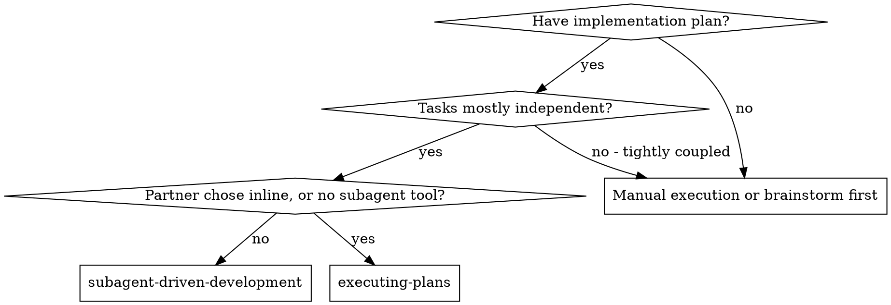
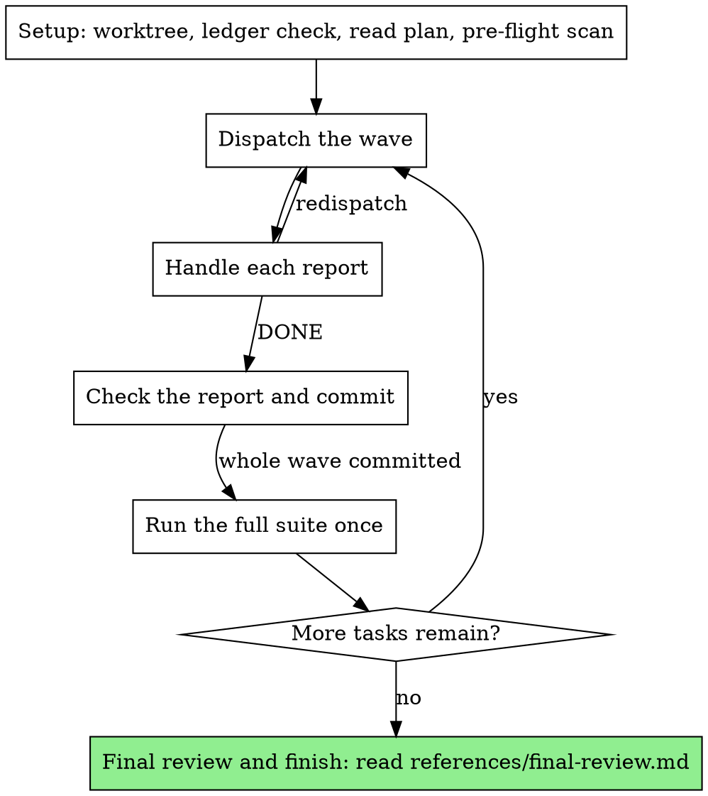

# Subagent-Driven Development

Execute a plan by dispatching one fresh builder subagent per task, independent tasks together as a wave. There is no per-task review: you check each report, commit each task yourself, and the whole change gets one review at the end.

**Why subagents:** You delegate tasks to specialized agents with isolated context. By precisely crafting their instructions and context, you ensure they stay focused and succeed at their task. They should never inherit your session's context or history — you construct exactly what they need. This also preserves your own context for coordination work.

**Core principle:** Fresh builder per task + orchestrator commits + one end review of the whole change = high quality, fast iteration

**Narration:** between tool calls, narrate at most one short line — the
ledger and the tool results carry the record.

**Continuous execution:** Do not pause to check in with your human partner between tasks. Execute all tasks from the plan without stopping. The only reasons to stop are the four named below, or all tasks complete. "Should I continue?" prompts and progress summaries waste their time — they asked you to execute the plan, so execute it.

**Rulings, not stalls.** A running plan does not wait on a human. Conflicts,
ambiguities, plan defects, a cap you would have asked to exceed — decide
them. The spec is the binding authority, the plan is its argument, and your
judgment settles what neither answers. Record every decision in the ledger as
`Ruling: <what you decided> — <why> — <what it costs if wrong>`, and keep
going. A wrong ruling costs rework your human partner can see and undo; a
session parked on a question costs their whole day and buys nothing.

Four things stop you, and only these: an irreversible or destructive
operation; a security-sensitive action; a side effect outside this worktree
that norms say you ask about first (a merge, a push to a shared branch, a
publish); and a plan so broken that every path forward is a guess. For those,
stop and ask. Before Task 1 one more thing stops you: a gate-check refusal
(see Setup); only your human partner can waive it.

## When to Use

**vs. Executing Plans (inline):**
- Fresh subagent per task (no context pollution) instead of one context doing every task
- Independent tasks build together as a wave instead of one after another
- No per-task review in either: one end review covers the whole change
- Costs a fresh context per task; inline costs one context
- Both run in this session, share the same plan workspace and ledger, and never pause between tasks

## The Process

## Setup

Ensure the work happens in an isolated workspace: use
superpowers:using-git-worktrees to create one or verify the existing one.
Never start implementation on a main/master branch without your human
partner's explicit consent.

Conversation memory does not survive compaction. In real sessions,
controllers that lost their place have re-dispatched entire completed task
sequences — the single most expensive failure observed. Track progress in
a ledger file, not only in todos.

- Each plan owns a workspace: at skill start, run this skill's
  `bash scripts/sdd-workspace PLAN_FILE` by its absolute path, from the
  working tree you're executing in — it prints the plan's git-ignored
  directory (under `<repo-root>/.superpowers/sdd/`), home to
  every artifact for THIS plan: ledger, briefs, reports.
  Another plan's directory is never yours to read or write.
- Check for this plan's ledger at `<workspace>/progress.md`. If one exists,
  read [references/resuming.md](references/resuming.md) before anything
  else: it says whose ledger it is, where to resume, and when to stop and ask.
- Create the ledger with its identity as the first line:
  `# SDD ledger — plan: <plan file path>`. Its second line is
  `Start: <sha>` with the output of `git rev-parse HEAD`.
- The ledger is your recovery map: the commits it names exist in git even
  when your context no longer remembers creating them. After compaction,
  trust the ledger over your own recollection.
- `git clean -fdx` will destroy the workspace (it's git-ignored scratch); if
  that happens, stop and show your human partner `git log --oneline`.

Read the plan once, note its context and Global Constraints, and create a
todo per task. If the plan names a Spec, read that too: the spec is the
authority the plan argues from, and conflicts inside the plan resolve
against it.

Before dispatching Task 1 — and when resuming a ledger with
neither a `gate-check: OK` nor a `gate-check waived` line — run
`bash <this skill's base directory>/scripts/gate-check PLAN_FILE` from the
repo holding the plan ([references/gate-check.md](references/gate-check.md)
says what it checks). Ledger `gate-check: OK`; on anything else, stop and
ask your human partner and do not dispatch. An explicit waiver in chat is ledgered as
`Ruling: gate-check waived — <reason given> — <cost if wrong>`, and rulings
made without a spec are provisional.

Before dispatching Task 1, read [references/preflight.md](references/preflight.md)
and run the conflict scan it describes. Its table and rulings go in the
ledger.

## Model Selection

Use the least powerful model that can handle each role to conserve cost and increase speed.

**Mechanical implementation tasks** (isolated functions, clear specs, 1-2 files): use a fast, cheap model. Most implementation tasks are mechanical when the plan is well-specified.

**Integration and judgment tasks** (multi-file coordination, pattern matching, debugging): use a standard model.

**Architecture and design tasks**: use the most capable available model.
A task that needs design judgment goes to Fable 5.2 (`claude-fable-5-2`),
one such task at a time.

**Always specify the model explicitly when dispatching a subagent.** An
omitted model inherits your session's model — often the most capable and
most expensive — which silently defeats this section.

**Turn count beats token price.** Wall-clock and context cost scale with how
many turns a subagent takes, and the cheapest models routinely take 2-3× the
turns on multi-step work — costing more overall. Use a mid-tier model as the
floor for implementers working from prose descriptions.
When the task's plan text contains the complete code to write, the
implementation is transcription plus testing: use the cheapest tier for
that implementer. Single-file mechanical fixes also take the cheapest tier.

**Task complexity signals (implementation tasks):**
- Touches 1-2 files with a complete spec → cheap model
- Touches multiple files with integration concerns → standard model
- Requires design judgment or broad codebase understanding → most capable model

## The Task Loop

**Small same-shape work:** when the plan lists several small edits of the
same kind across files, read [references/batching.md](references/batching.md)
before dispatching them.

Everything you paste into a dispatch prompt — and everything a subagent
prints back — stays resident in your context for the rest of the session
and is re-read on every later turn. Hand artifacts over as files.

**Waiting on dispatched subagents:** read
[references/waiting.md](references/waiting.md) before any wait.

### 1. Dispatch

Tasks whose `Depends on` tasks are all complete form a wave and are dispatched together in one message, as foreground calls.
A wave of one is normal. A task with no `Depends on` line depends on the task before it.
Two tasks that list the same file never share a wave: the later one waits.

Builders run no git command that writes: no `git add`, `git mv`, `git rm`,
`git commit`, `git stash`. A builder writes its files (a rename is a new
file plus a deleted file), runs its own task's tests, and reports. You
commit, so builders in a wave cannot collide in the index.

- **Task brief:** before dispatching an implementer, run this skill's
  `bash scripts/task-brief PLAN_FILE N` by its absolute path, from the
  working tree you're executing in — it extracts the task's full text to a
  uniquely named file and prints the path. Compose the dispatch so the
  brief stays the single source of
  requirements. Your dispatch should contain: (1) one line on where this
  task fits in the project; (2) the brief path, introduced as "read this
  first — it is your requirements, with the exact values to use verbatim";
  (3) interfaces and decisions from earlier tasks that the brief cannot
  know; (4) your resolution of any ambiguity you noticed in the brief;
  (5) the report-file path and report contract. Exact values (numbers,
  magic strings, signatures, test cases) appear only in the brief. Never
  make a subagent read the whole plan file.
- **Report file:** name the implementer's report file after the brief
  (brief `…/task-N-brief.md` → report `…/task-N-report.md`) and put it in
  the dispatch prompt. The implementer writes the full report there and
  returns only status, files changed, a one-line test summary, and concerns.
- A dispatch prompt describes one task, not the session's history. Do not
  paste accumulated prior-task summaries ("state after Tasks 1-3") into
  later dispatches — a real session's dispatch hit 42k chars of which 99%
  was pasted history. A fresh subagent needs its task, the interfaces it
  touches, and the global constraints. Nothing else.
- The dispatch carries the no-subagents contract (it is in the
  implementer template): the implementer never dispatches subagents —
  not helpers, and never a reviewer. Review happens once, at the end, on
  the whole change. In real sessions, every reviewer a worker spawned
  duplicated a review the controller ran anyway.
- If the ledger holds a failure or ruling in the area this task touches,
  carry a pointer to that ledger entry in the dispatch.
- Record each builder's agent identity from the dispatch result — a
  failure in a test its task owns goes back to that agent.

Template: [implementer-prompt.md](implementer-prompt.md)

### 2. Handle the report

Implementer subagents report one of four statuses. Handle each appropriately:

**DONE:** go to step 3.

**Any other status** (DONE_WITH_CONCERNS, NEEDS_CONTEXT, BLOCKED): read
[references/handling-reports.md](references/handling-reports.md) and follow
it, every time you get one.

If the implementer asks questions — before starting or mid-task — answer
clearly and completely, provide additional context if needed, and don't
rush it into implementation.

### 3. Check the report

For each DONE report, confirm with `git status` and `git diff --stat` that
the changed files are the task's Files, then commit that task alone:
`git add -- <its files>`, then `git commit --only -- <its files>`, message
starting `Task <N>:`.

- A changed path that belongs to no task in the wave stops the wave for a ruling.
- A builder's test failure during a wave is rerun alone after the wave
  before it counts: another builder's half-written files may have caused it.
- After the whole wave is committed, run the full test suite once.
- A failure in a test one task owns goes back to that task's builder, once.
- A failure no single task owns is yours: find the combination, write a
  reproducer, make one targeted dispatch.
- Whatever still fails is ledgered with its reproducer and appended to the
  end review's focus text, and tasks that depend on the tasks involved do
  not start until it is fixed or ruled.

A fix from a redispatch is checked and committed the same way.

### 4. Complete

Append the completion line to the ledger in the same message as your other
bookkeeping, then mark the todo complete:

`Task <N>: complete (commit <sha7>, tests 
)`

## Final Review

When every task is complete, read
[references/final-review.md](references/final-review.md) and follow it. It
hands the whole change to one end review and says how you finish.

## Common Rationalizations

| Excuse | Reality |
|--------|---------|
| "I'll fix it myself, dispatching is overhead" | Controller fixes pollute your context and blur which task owns the change. The builder is redispatched. |
| "Ledger bookkeeping is overhead" | The ledger is what survives compaction. Controllers without one have re-dispatched entire completed task sequences. |
